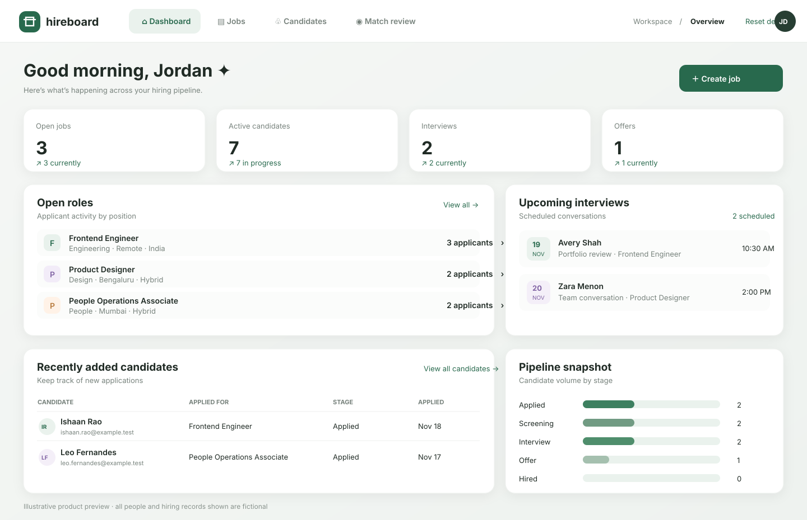

# Hireboard

Hireboard is a lightweight applicant tracking demo for a recruiter or small hiring team. It brings open roles, candidate stages, interview scheduling, and recent activity into one workspace, with an explainable phrase comparison for candidate-entered text.

> **Demo safety:** Hireboard uses synthetic sample data and is not production hiring software. Do not enter real candidate information. Candidate data and any text entered in Match review stay in this browser's local storage or page memory; there is no shared server or account system.

## Features

- Recruiting dashboard with open job, active candidate, interview, and offer counts.
- Upcoming interview schedule and a stage-by-stage pipeline snapshot.
- Job list with role details, requirements, applicant totals, and close/reopen controls. Create jobs in the browser.
- Candidate intake for explicitly fictional records, with a required synthetic-data confirmation and `@example.test` email validation.
- Candidate pipeline with searchable Kanban and table views, keyboard-accessible stage controls, profile details, and CSV export with spreadsheet formula protection.
- Interview scheduling on candidate profiles. This records a local demo event; it does not send invitations.
- One-click restoration to the original sample workspace.
- Match review that displays listed phrases found and not found in entered text.
- Responsive layout, keyboard focus indicators, and synthetic starter records.

## Product preview

The dashboard brings together a recruiting summary, open roles, recent activity, upcoming interviews, and a pipeline snapshot. The preview below uses fictional sample data, as does the running demo.



## Typical workflow

1. Review the dashboard to see open roles, active candidates, interview counts, offers, and upcoming conversations.
2. Create or update a job, then review candidates in the pipeline using search, role, stage, and Kanban or table views.
3. Open a candidate profile to review their fictional details, change their stage, or schedule a local demo interview.
4. Use Match review to compare a role's listed requirement phrases with entered text. The app shows each phrase it found or did not find so the result is easy to inspect.
5. Export the candidate list as CSV for a spreadsheet workflow, or reset the browser workspace to restore the sample records.

## Tech and structure

The app uses native HTML, CSS, and JavaScript modules with no runtime dependencies. A small Node.js static server serves the files. Domain rules are in `src/domain.js`, sample and local persistence in `src/data.js`, and screen composition and browser interactions in `src/app.js`.

| Path | Purpose |
| --- | --- |
| `index.html` | App shell and navigation landmarks |
| `src/app.js` | Screen rendering, interactions, and local workflow state |
| `src/domain.js` | Candidate, job, interview, phrase-review, and CSV rules |
| `src/data.js` | Fictional starter records and browser storage helpers |
| `src/styles.css`, `src/product.css` | Layout, responsive behavior, and visual styling |
| `server.js` | Minimal Node.js static file server |
| `tests/domain.test.js` | Domain and export behavior checks |

## Run locally

Requires Node.js 20 or newer.

```sh
npm start
```

Open [http://localhost:4173](http://localhost:4173). To use another port, set `PORT` before starting, for example `PORT=8080 npm start`.

There are no package dependencies to install. Keep the terminal running while using the app; stop it with `Ctrl+C` when finished.

## Tests

Run the domain and CSV tests with:

```sh
npm test
```

The tests cover empty and partial matching, stage validation, candidate filtering, synthetic-only candidate creation, interview scheduling, job status changes, local persistence/migration, and CSV escaping/formula protection.

## Sample data and persistence

The included roles, applicants, dates, names, interview details, and `.test` email addresses are fictional. The initial workspace is copied into browser storage on first use; job and candidate additions, stage changes, interview scheduling, and activity persist in this browser under `hireboard-demo-v1`. Data is local to the browser profile and is not shared between users or devices. Use **Reset** in the workspace sidebar to restore the starter records. Earlier demo data is upgraded locally when the app adds the sample interview schedule.

Because persistence uses browser local storage, clearing site data or switching browser profiles creates a separate workspace. The demo has no login, server-side storage, or sync between browsers.

## Match calculation and responsible use

The review compares each role's explicitly listed requirement phrase with the text entered by the user, ignoring letter case. A phrase is counted as found when it appears as a literal substring. Duplicate and blank requirements are removed. The displayed percentage is `found requirement phrases ÷ total listed requirement phrases × 100`, rounded to the nearest whole percent. If there are no requirements, no percentage is shown.

This simple phrase overlap is only a review aid. It does not infer equivalent terms, verify a skill, or evaluate a person's quality. A missing phrase is not evidence that a candidate lacks a skill. The score must not be used to rank, reject, or make hiring decisions. No protected or sensitive traits are used.

## Limitations

- This is a local, single-browser demo without authentication, shared storage, or a production database.
- Interview times are demo records and do not create calendar events or send messages.
- Resume text is entered manually; there is no file upload or document parsing.
- The phrase check is literal and can miss synonyms or context.
- The app is not production HR software and has not been designed for handling real candidate data.

## Security and privacy notes

Candidate creation is intentionally restricted to fictional `@example.test` addresses and a synthetic-record confirmation. This protects the demo workflow from accidentally becoming a place to store real applicant data; it is not a substitute for production access controls. Match review text remains in the current page unless the user saves it with a candidate record. CSV export escapes fields and prefixes spreadsheet formula-like values to reduce formula injection risk.

## Deployment

No live demo has been deployed yet. The static files can be hosted on a Node-compatible platform that supports `npm start`; set `PORT` if the host provides one. Add the verified URL here after deployment.

## License

Hireboard is available under the MIT License. See [LICENSE](LICENSE).
